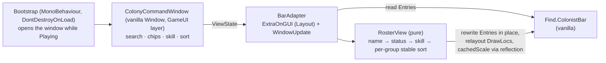

# Repository Guidelines

## Project Overview

**Colony Command** — a RimWorld **1.6**, Core-only, UI-only C# mod that adds name search, status/skill filters
and sorting to the vanilla top colonist bar. Spec: `Colony_Command_Specs.docx`. Plan and verified engine facts:
`docs/plan.md`. Phases and progress: `TODO.md`.

Identity (in `tools/env.sh`): `MOD_NAME=ColonyCommand` (assembly, `Source/` dir, `Mods/` dir, log tag
`[ColonyCommand]`), `MOD_ID=josh9817.colonycommand` (packageId — never change once saves exist).

### Hard constraints (from the spec and user decisions — do not reopen; ask the user instead)

- **Core only.** No DLC requirements, no other mods required at runtime. The shipped assembly **never references
  Harmony** — not even as a fallback (user decision Q2: if the native path fails, reduce the feature and ask).
- **No save data.** No `ExposeData`, no `GameComponent`/`MapComponent`/`WorldComponent` (all are serialized into
  the save), no Defs, no mod settings. UI state is memory-only and resets on load.
- **Never mutate game data.** Not pawns, names, selection, jobs, work settings, or
  `playerSettings.displayOrder` (vanilla drag-reorder writes it — neutralise reorder while a view is active).
- **Vanilla look.** Reuse vanilla widgets (`QuickSearchWidget`, `Widgets`, `FloatMenu`), textures and colors.
- Predicates decided by the user: Injured = `hediffSet.HasNaturallyHealingInjury()`; Idle = exactly the bar's
  idle-icon condition in `ColonistBarColonistDrawer`.

## Architecture & Data Flow



- `ColonistBar.Entries` / `DrawLocs` return the bar's private lists **by reference**; the adapter rewrites them
  in place after each vanilla recache. Untouched when no criteria are active and sort = vanilla.
- The window re-applies the view during the `Layout` event (bar ignores `Layout`), so a tick-driven
  `MarkColonistsDirty` never reaches a drawn frame or a click. Details and open **[verify]** items: `docs/plan.md`.
- Nothing is saved: windows live in `UIRoot.windows`; the bootstrap is a Unity object.

## Key Directories

| Path | Purpose |
| --- | --- |
| `About/` | `About.xml` (supportedVersions 1.6, no dependencies), `Preview.png` |
| `Source/ColonyCommand/` | The mod assembly (`net472`, `Krafs.Rimworld.Ref 1.6.4871`, **no Harmony**) |
| `Languages/English/Keyed/` | UI strings |
| `1.6/Assemblies/` | Build output (git-ignored) |
| `Tests/ColonyCommandTests/` | **Test-only mod**: adapted `AutoTest.cs` driver, colonist fixtures, scenarios. May reference and load Harmony (declares it as a dependency); references the main assembly. Never packaged |
| `tools/` | Toolchain adopted from the modding center |
| `docs/` | `plan.md` (this mod), `test-runs.md` (run log), plus center snapshots: `playbook.md`, `testing.md`, `gotchas.md`, `tooling.md` |
| `templates/` | `handoff-TEMPLATE.md` for context-limit hand-offs |
| `.tools/decomp/` | Decompiled 1.6 `Assembly-CSharp` (git-ignored; copied from a sibling mod repo, same game version) |
| `.devlog/`, `dist/` | Generated test state / packaged release (git-ignored) |

## Development Commands

```bash
tools/vanilla.sh grep <regex>                    # look up vanilla source + Core Defs BEFORE writing engine code
tools/vanilla.sh def <defName>                   # a Core def with its ParentName chain
tools/build.sh                                   # lint → dotnet build (+ the test-only mod, Tests/) → 1.6/Assemblies (build id in .devlog/last-build)
tools/autotest.py run "<exact scenario names>"   # build + isolated instance + ONLY the named scenarios + log diff
tools/autotest.py baseline                       # error signatures without the mod (once per environment)
tools/autotest.py stop                           # end the test instance
tools/status.sh                                  # environment + restart verdict
tools/package.sh                                 # clean tree → dist/ColonyCommand (+ BUILD stamp)
tools/qblog.sh mark|since-mark|errors            # user-loop Player.log checks
tools/screenshot.sh [label]                      # game window only
git -c safe.directory="$PWD" <cmd>               # mount is root-owned: always pass safe.directory
```

`autotest.py` needs `MOD_NAME`/`MOD_ID` exported when called directly (shell tools get them from `env.sh`):
`source tools/env.sh && tools/autotest.py run "<names>"` does that. It loads the test-only mod by convention
(`MOD_EXTRA_MODS` defaults to `<MOD_ID>tests`, linked into the game's `Mods/` on first use) and the test window is
800x500 (`MOD_SCREEN`): vanilla hides the colonist bar below that, so a smaller window can't test it.
Global options go before the subcommand; exit codes 0 pass · 1 fail · 2 hang/crash/timeout · 3 env broken.
Steam must be running (workshop Harmony loads only then); the harness always loads Harmony, which the test mod
may use.

## Code Conventions & Common Patterns

- **Lookups before memory**: every engine API used is checked in `.tools/decomp/`; cite the class/member in
  `docs/plan.md` when it shapes a design decision. Never use RimWorld 1.7 information.
- C#: namespace `ColonyCommand`; log only through one helper prefixed `[ColonyCommand]`; `Log.ErrorOnce` for
  anything that could repeat per frame. No allocations per OnGUI event on the hot path (reuse lists).
- Reflection on private vanilla members is resolved **once** at startup and **fails closed**: feature off + one
  error, never a per-frame exception.
- `RosterView` stays pure (no `GUI`, `Widgets`, `Find`) so its logic is easy to assert.
- Strings via `Translate()` keys `ColonyCommand_*`.
- Commits: small, imperative subjects, optional `P1:`-style phase prefix; never commit `.devlog/`, `.tools/`,
  `dist/` or build output; don't push unless asked.
- Tooling: fix general tool bugs in the modding center and port here in the same change (porting rule).
  Tool rules: Bash `set -euo pipefail`; Python 3 stdlib only under `python3 -I`; shared values only in `tools/env.sh`.

## Testing & QA

- Two loops (`docs/testing.md`): **autotest** — scenarios in the test-only mod, run via
  `tools/autotest.py run "<names>"`; **user-in-the-loop** — the user plays, the agent checks the log
  (`qblog.sh`) and that the loaded build id equals `.devlog/last-build`.
- Fixtures are **colonists only** (names, drafted, injury hediff, skill levels, mood offset) — YAGNI/KISS; no rooms,
  power, items or animals.
- User-in-the-loop only: Core-only/no-Harmony load of the package (the harness always loads Harmony) and the
  display-size × UI-scale matrix.
- A TODO box is ticked only after a run proved it, naming the run, with a row in `docs/test-runs.md`.
- User's game and profile are off limits except read-only log tools; back up (`tools/backup-saves.sh`) before
  any user-loop session.

## Testing scope (strict rule — no exceptions beyond the one named here)

- **No full sequences.** Every test run names the exact scenarios the current change needs:
  `tools/autotest.py run "<exact scenario names>"`. Never `run` or `pkg-run` with an empty filter, never the
  in-game "Run all", never every scenario in sequence "to check everything". After a fix, rerun only the
  scenarios that failed plus any whose code path the fix touched.
- **No scope creep.** Test only what the current change or plan target touches. Don't add scenarios, fixtures or
  assertions for features outside the target, and don't fix or test unrelated problems found along the way:
  note them in `TODO.md` and ask the user.
- **Well-defined state only.** A scenario that runs builds its own fixtures from a known start, states its
  precondition, its trigger and its expected outcome, asserts on its own fixture targets (never global map
  state), and removes its fixtures. It never depends on what an earlier scenario left behind.
- **Every scenario targets a failure mode.** Each run scenario names the way the change could break (wrong
  result, exception, null/despawned/dead target, missing def, save/load round trip, removal) and asserts either
  the correct result or a graceful failure (no exception, no new red error, a clean fallback). A scenario that
  catches nothing the change could break is not run.
- **Record why.** Each `docs/test-runs.md` row lists the scenarios run and the failure mode each one covers.
- **Sole exception: the release gate.** A full "Run all" on the packaged copy (`tools/autotest.py pkg-run`) is
  allowed only as the release gate, started by the user or with their explicit approval for that release.

## Tooling provenance

`tools/` and the center docs are snapshots of `/mnt/0B8533211952FCF2/rimworld-modding-center` at `0542d72`.
Other repos on this mount are the user's: read freely, never modify them from here.
