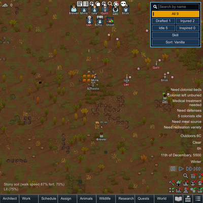
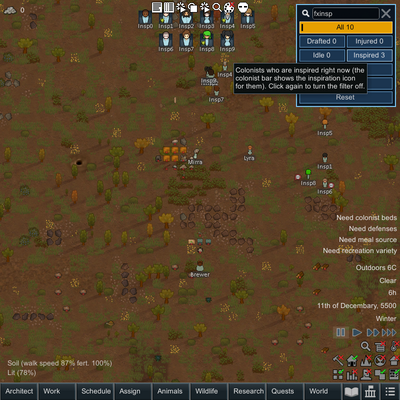
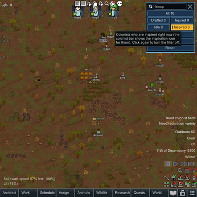
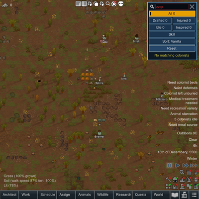
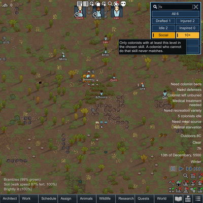
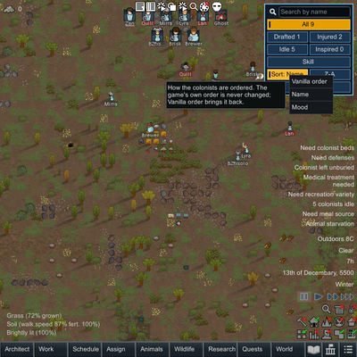

# Colony Command

Find colonists without leaving the map. **Colony Command** is a RimWorld **1.6**, Core-only, UI-only mod that adds a panel to the vanilla colonist bar for searching, filtering and sorting your roster.



## Features

- **Search by name** — narrow the bar to matching colonists as you type.
- **Filter by status** — Drafted, Injured, Idle or Inspired.
- **Filter by skill and minimum level**.
- **Sort** by name, mood or the selected skill — or restore vanilla order.
- **Reset** the controls to show the original bar.

The panel sits below the Learning Helper and folds into a compact menu when space is limited. Filters and sorting only change the *displayed view*; they never change colonists, their jobs, or their saved order. UI state is not saved and resets when a game is loaded, so the mod can be added to or removed from an existing save.

## Screenshots

| | |
|---|---|
|  |  |
|  |  |
|  |  |

## Requirements

- RimWorld **1.6**
- **Core** only — no DLC and no other mods are required.

## Installation

1. Download or clone this repository into your RimWorld `Mods` folder (or subscribe via the Steam Workshop once published).
2. Enable **Colony Command** in the in-game mod list.

## Building from source

The mod targets `net472` and builds against the RimWorld 1.6 reference assemblies (`Krafs.Rimworld.Ref`). The build toolchain lives in `tools/`:

```bash
tools/build.sh     # lint → build the mod and the test-only mod → 1.6/Assemblies
tools/package.sh   # clean package → dist/ColonyCommand
```

## License

This project is licensed under the MIT License — see [`LICENSE`](LICENSE).

The mod's `About/Preview.png` is the promotional cover illustration (AI-generated, not an in-game screenshot) with the mod title and tagline set over it. The artwork itself is described in [`assets/artwork/README.md`](assets/artwork/README.md).
