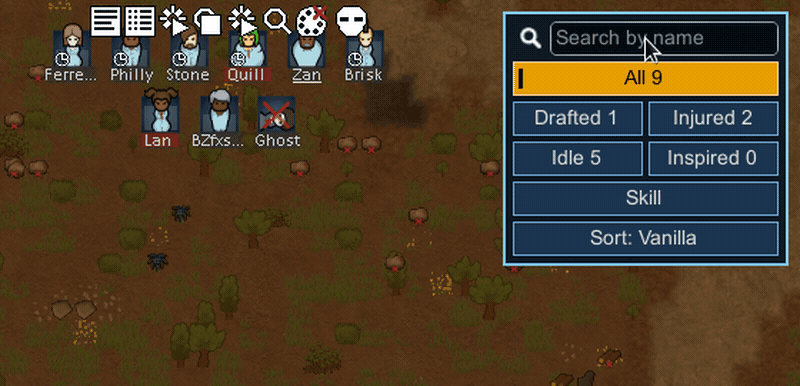
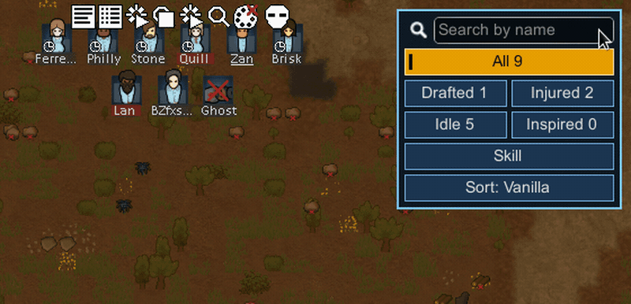
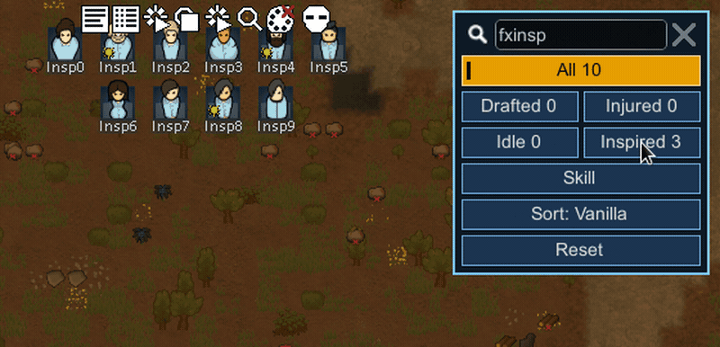
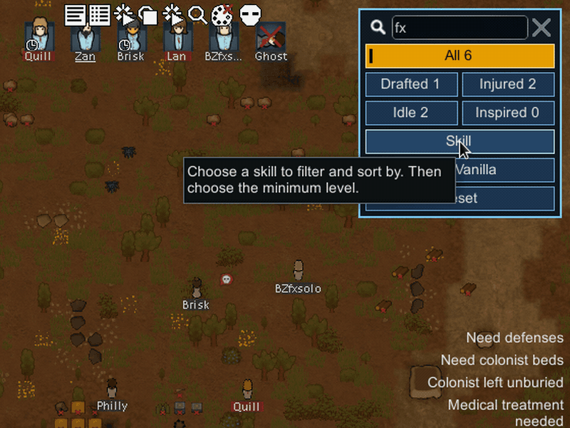
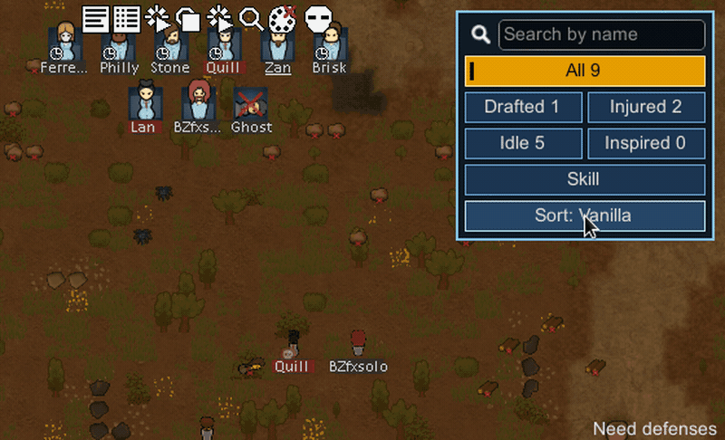
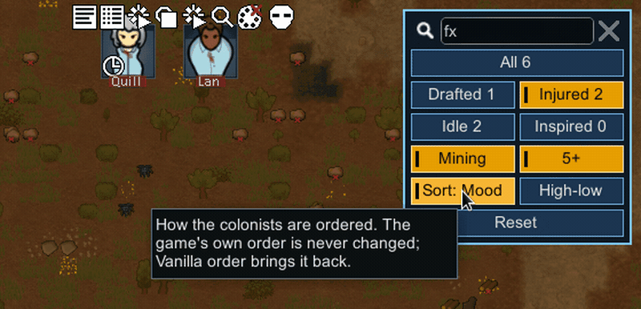
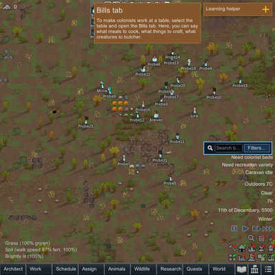

<p align="center">
  
</p>

<h1 align="center">Colony Command</h1>

<p align="center">
  <strong>Find colonists without leaving the map.</strong><br>
  A search, filter and sort panel for the vanilla colonist bar.
</p>

<p align="center">RimWorld <strong>1.6</strong> · Core only · UI only · nothing saved to your game</p>

<p align="center"><sub>The cover is an AI-generated promotional illustration, not a gameplay screenshot.</sub></p>

Colony Command adds a small panel to the vanilla colonist bar, so you can search, filter and sort your roster in place
instead of hunting through a dozen portraits. Filters and sorting only change the *displayed view*; they never change
colonists, their jobs, or their saved order.

## See it in action

### Search by name

Narrow the bar to matching colonists as you type. Here `quill` takes the bar from nine colonists to one.



### Filter by status

**Drafted**, **Injured**, **Idle** or **Inspired**. Every chip shows a live count; click one to filter, click it again
to turn it off.





### Filter by skill and minimum level

Pick a skill, then a minimum level (Any, 0+, 5+, 10+ or 15+). A colonist who cannot do the skill never matches.



### Sort

Order the bar by **name**, **mood** or the selected **skill**, and flip the direction. *Vanilla order* brings the game's
own order back; colonists without a value (no mood, no usable skill) always come last.



### Reset

One click clears the search, the filters and the sorting, and shows the colonist bar as the game has it.



> These clips are real screen recordings of the mod running in its automated test, cropped and zoomed to the bar and
> the panel. The colonists are test fixtures, some states are set up by the test, and waiting time was trimmed out. See
> [`assets/README.md`](assets/README.md) for exactly how they were recorded and what the test sets up for them.

## Good to know

- The panel sits in the right column, below the Learning Helper, and folds into a compact **Search / Filters** menu when
  space is limited.
- When nothing matches, the panel says **No matching colonists** and offers Reset.
- Filters and sorting only change what the bar shows. UI state is not saved and resets when a game is loaded, so the mod
  can be added to or removed from an existing save.

| | |
|---|---|
|  |  |
| No matches: the empty state with Reset | Compact panel: the Learning Helper leaves room only for the folded controls |

## Requirements

- RimWorld **1.6**
- **Core** only — no DLC and no other mods are required.

## Installation

1. Copy the packaged `dist/ColonyCommand` (built by `tools/package.sh`, or from an official release archive) into RimWorld's `Mods` folder — or clone this repository there, the repository root is itself a valid mod.
2. Enable **Colony Command** in the in-game mod list.

## Building from source

The mod targets `net472` and builds against the RimWorld 1.6 reference assemblies (`Krafs.Rimworld.Ref`). The build toolchain lives in `tools/`:

```bash
tools/build.sh     # lint → build the mod and the test-only mod → 1.6/Assemblies
tools/package.sh   # clean package → dist/ColonyCommand
```

## License

This project is licensed under the MIT License — see [`LICENSE`](LICENSE).

The mod's `About/Preview.png` is the promotional cover illustration (AI-generated, not an in-game screenshot) with the mod title and tagline set over it. The artwork itself is described in [`assets/artwork/README.md`](assets/artwork/README.md).
